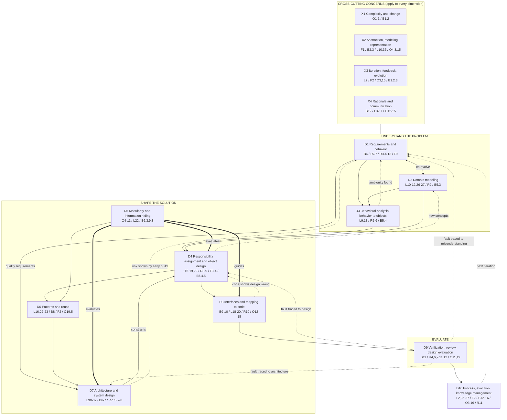

# An Integrated Conceptual Framework for Software Engineering: A Synthesis of Five Foundational Books

*A general, project-independent framework derived from Ousterhout, Larman, Rosenberg & Stephens, Bruegge & Dutoit, and Fowler.*

**Labeling convention used throughout.** **\[Source\]** marks a claim I took directly from the uploaded text. **\[Synthesis\]** marks my own interpretation, reconciliation, or structuring, which the authors do not state. References use each book’s own chapter and section numbers (printed page numbers where I verified them against the uploaded editions).

---

## 1. Executive Overview

### 1.1 What this document is

This document builds a reusable mental model of software engineering and object-oriented design from five books that overlap heavily but were written with different purposes: one about *why software becomes hard* (Ousterhout), one about *how to reason methodically from requirements to object design* (Larman), one about *a lean, use-case-driven path from requirements to code* (Rosenberg & Stephens), one about *software engineering as a whole discipline* including change management (Bruegge & Dutoit), and one about *the notation we use to think and talk about designs* (Fowler).

### 1.2 The framework in one paragraph

**\[Synthesis\]** All five books can be read as answers to one underlying problem: *software systems exceed what any one person can hold in mind, and the world around them keeps changing.* Ousterhout names the problem **complexity** (Ch. 1–2); Bruegge & Dutoit name it **complexity and change** (Preface; §1.2). The books then offer four families of response, and the framework is organized around them: (1) **understand the problem** before and while designing (requirements, domain model, behavior analysis); (2) **shape the solution** by assigning responsibilities, drawing boundaries, hiding information, reusing patterns, and decomposing into architecture; (3) **evaluate the result** through reviews, tests, and design critique; and (4) **keep learning** through iteration, rationale, and model/code synchronization. Representation (UML, comments, code) and iteration cut across all four.

### 1.3 Reading provenance, editions, and limits (please read)

I extracted the text of all five PDFs and read them selectively but substantively. Being exact about this matters, because you asked me not to claim inspection I did not perform.

| Book (edition in your upload) | Text layer | Read closely | Surveyed only via TOC/headings/openings |
| --- | --- | --- | --- |
| Ousterhout, *A Philosophy of Software Design* (2018; 21 chapters) | Clean | Preface; Ch. 1–4, 19, 21; key passages of Ch. 5–11, 15, 20; the Summary of Design Principles and Red Flags | Ch. 12–14, 16–18 (chapter openings only); the long worked examples in Ch. 5–10 |
| Larman, *Applying UML and Patterns* — **2nd edition (UML 1.x era)** | OCR-derived (some noise) | Ch. 1–2; §6.1–6.5, 6.15–6.16; Ch. 10 (opening, §10.9); Ch. 16 (§16.1–16.8); Ch. 22 (Protected Variations); Ch. 30 opening; Ch. 32 (§32.6–32.7); Ch. 35; §20.8–20.9 | Ch. 9, 11–14, 17–19, 21, 23–29, 31, 33–34, 36–38 (TOC and headings only) |
| Rosenberg & Stephens, *Use Case Driven Object Modeling with UML: Theory and Practice* (2007) | Clean | Preface; Introduction; Ch. 1; Ch. 2–3 (openings and guideline lists); Ch. 5 (opening, rules); Ch. 7 (opening, guidelines); Ch. 11 (opening, guidelines); Ch. 12 (guidelines, testing kinds) | Ch. 4, 6, 8–10, 13, Appendices (TOC and Ch. 1 summaries) |
| Bruegge & Dutoit, *OO Software Engineering Using UML, Patterns, and Java* — 3rd ed. | Clean | Ch. 1 (§1.1–1.4); §2.3; Ch. 4 (§4.2–4.4 opening); Ch. 5 (§5.1–5.4.1); Ch. 6 (§6.1–6.3); Ch. 7 (§7.2–7.4 opening); Ch. 8 (§8.1–8.3, opening of 8.4); Ch. 9 (§9.1–9.3.2); Ch. 10 (§10.1–10.3.2); Ch. 11 (§11.2–11.3.2); Ch. 12 (§12.1–12.2); parts of Ch. 15–16 | Ch. 3, 13, 14; §2.4; most of §4.4–4.6, 5.4.2–5.4.11, 6.4, 7.4.x, 9.4, 10.4, 11.4; Appendix A |
| Fowler, *UML Distilled* — 3rd ed. (UML 2.0, 2003) | Clean (reflowed 118-page PDF; page numbers below are PDF pages) | Ch. 1–2 in full; the “When to Use” sections of every diagram chapter; Ch. 9 (use cases) opening | Notation details in Ch. 3–8, 10–17 |

**Consequences for you.** (a) Where I describe a section I did not read closely, I say so. (b) Larman’s chapter numbers in your edition differ from the 3rd edition’s; every Larman reference here is to *your* 2nd edition. (c) Larman’s PDF is OCR-derived and I corrected obvious OCR noise by context only. (d) The books are 2002–2018 texts; Section 10 flags what that implies.

### 1.4 The five most important findings

1. **\[Source + Synthesis\]** *Complexity management is the shared purpose, but each author operationalizes it at a different level:* Ousterhout at the module/interface level, Larman at the responsibility level, Bruegge & Dutoit at the model, subsystem, and project level, Rosenberg & Stephens at the requirement-to-code traceability level, Fowler at the communication level.
2. **\[Source\]** *The books reject a strict waterfall interpretation* (Ousterhout §1; Larman §2.1, §2.7–2.8; Fowler Ch. 2; Bruegge §1.2.3, §15.4.1), **but Rosenberg & Stephens deliberately stay process-neutral** (Preface, “ICONIX: A Pluggable Process”) while prescribing a strongly ordered sequence of steps *within* a batch of use cases (Ch. 1).
3. **\[Source\]** *Real, unforced disagreements exist*: how abstract use cases should be (Larman vs. Rosenberg & Stephens), whether to write tests first (Larman §20.9 vs. Ousterhout §19.4), and whether small cohesive classes or “deep” modules are the better default (Larman §16 “High Cohesion” vs. Ousterhout §4.5–4.6).
4. **\[Source\]** *Information hiding is the deepest bridge between the books.* Larman states that Protected Variations is essentially Parnas’s information hiding (Ch. 22), and both Larman and Ousterhout warn that private fields are not the same thing as information hiding (Larman Ch. 22; Ousterhout §5.1).
5. **\[Synthesis\]** *Feedback is the framework’s organizing logic, not sequence.* Bruegge & Dutoit’s Figure 1-2 caption says the activity diagram shows only logical dependencies and that activities can occur in parallel and more than once; Fowler calls revisiting earlier decisions “backflows”; Larman builds the whole presentation on build–feedback–adapt cycles.

---

## 2. Individual Book Analyses

Each analysis follows your nine questions in compressed form.

### 2.1 Ousterhout — *A Philosophy of Software Design*

**Central philosophy.** **\[Source\]** The book is “about one thing: complexity” (Ch. 21). Software is limited by our ability to understand what we build (§1), so design means continually reducing complexity.

**Definition of good software engineering.** **\[Source\]** A good system is *obvious* and easy to modify (§2.1–2.2); “working code isn’t enough” (Ch. 3). Good design is an ongoing investment, not an up-front phase (§1, §3.2).

**Main problems.** **\[Source\]** Complexity is defined as anything in a system’s structure that makes it hard to understand and modify (§2.1). Its symptoms are *change amplification*, *cognitive load*, and *unknown unknowns* (§2.2), and its causes are *dependencies* and *obscurity* (§2.3). It is *incremental*, so “sweat the small stuff” (§2.4).

**Conceptual foundations.** **\[Source\]** Modular design (§4.1); the split of every module into *interface* and *implementation* (§4.1–4.2, including informal interface content); *abstraction* as omission of unimportant detail, with “false abstraction” when important detail is omitted (§4.3); *deep* vs. *shallow* modules as benefit-versus-interface-cost (§4.4–4.5).

**Methods and processes.** **\[Source\]** A strategic, investment mindset spending roughly 10–20% of time on design improvement (§3.2–3.3; he notes the figure is a suggestion and that the productivity curves are qualitative, Fig. 3.1); incremental development whose increments are *abstractions, not features* (§19.2, Summary of Design Principles #15); *design it twice* (Ch. 11); *write comments first* as a design tool (Ch. 15); code review as the primary way to learn the principles (§1.1).

**Key principles and techniques.** **\[Source\]** Fifteen principles and a list of red flags are summarized at the back of the book (e.g., deep modules; simple common-case interfaces; simple interface over simple implementation; general-purpose modules are deeper; different layer, different abstraction; pull complexity downward; define errors out of existence). Red flags include Shallow Module, Information Leakage, Temporal Decomposition, Pass-Through Method, Conjoined Methods, and Nonobvious Code.

**Assumptions and limitations.** **\[Source\]** It is explicitly “an opinion piece” grounded in the author’s experience and a Stanford course (Preface). It offers no empirical validation (Fig. 3.1 note) and warns each principle has limits (“Taking it too far” sections, §1.1). **\[Synthesis\]** It is almost silent on requirements, stakeholder communication, architecture documentation, and team process; its unit of analysis is the module (class, method, subsystem, service; §4.1).

**Contribution.** **\[Synthesis\]** It supplies the book set’s *evaluative core*: a vocabulary (depth, leakage, obscurity) for judging whether any decomposition, from a GRASP assignment to a subsystem boundary, actually reduces complexity.

**Relationship to the others.** **\[Source\]** Ch. 19 directly evaluates OO inheritance, agile, unit tests, TDD, design patterns, and getters/setters against complexity. **\[Synthesis\]** He agrees with Bruegge & Dutoit and Larman on implementation inheritance (§19.1) and on pattern over-application (§19.5), and disagrees with Larman on test-first practice (§19.4 vs. Larman §20.9) and, implicitly, on small-class cohesion (§4.6).

### 2.2 Larman — *Applying UML and Patterns* (2nd edition)

**Central philosophy.** **\[Source\]** The “desert island” skill of OOA/D is assigning responsibilities to software components (§1.2). The book’s objective is to help people create object designs “through the application of a set of explainable principles and heuristics” (Preface, Objectives).

**Definition of good SE.** **\[Source\]** Analysis is “do the right thing”; design is “do the thing right” (§1.3). Good design supports robustness, maintainability, and reusability (§1.2), and good process is iterative, risk-driven, and adaptive (Ch. 2).

**Main problems.** **\[Source\]** How to move methodically from requirements to code without “magic and vagueness” (Ch. 16 opening); how to choose among alternative object designs; how to protect a design against instability (Ch. 22).

**Conceptual foundations.** **\[Source\]** Use cases as written stories of goals, explicitly *not* object-oriented (§6.1, §6.15); the domain model as a *visual dictionary* of real-world conceptual classes, not software classes (Ch. 10 Key Ideas); the *representational gap* between mental domain model and software representation (§10.9); responsibilities as *knowing* and *doing* (§16.1); patterns as named problem/solution pairs with trade-offs (§16.3).

**Methods and processes.** **\[Source\]** The Unified Process as *example* process: short timeboxed iterations, four phases, optional artifacts selected in a Development Case, an “agile UP” (Ch. 2). Per-iteration chain: use cases → system sequence diagrams → domain model → operation contracts → interaction diagrams under GRASP → design class diagrams → code (Preface, Book Organization; Ch. 9–20, from TOC).

**Principles and techniques.** **\[Source\]** GRASP: Information Expert, Creator, Controller, Low Coupling, High Cohesion (Ch. 16); Polymorphism, Pure Fabrication, Indirection, Protected Variations (Ch. 22). Low Coupling and High Cohesion are *evaluative* principles applied to every decision (§16.x “Discussion”). Don’t Talk to Strangers is folded into Protected Variations in this edition (Ch. 22).

**Assumptions and limitations.** **\[Source\]** The reader already programs in an OO language and knows the basic OO vocabulary (Preface, Prerequisites). All artifacts are optional (§2.5). **\[Synthesis\]** The case study is a single domain (POS), the technology context is early-2000s Java/UML 1.x, and architecture is treated as an introduction (Ch. 30–32), not the book’s center.

**Contribution.** **\[Synthesis\]** The most explicit, teachable *reasoning method* in the set: it shows how a designer decides where a responsibility belongs and what to check afterwards (coupling, cohesion).

**Relationship to others.** **\[Source\]** Recommends Fowler for notation (§1.7); equates Protected Variations with information hiding and cites Parnas (Ch. 22). **\[Source\]** Adopts Cockburn-style use cases (Preface, Enhancements), and endorses test-first as an XP practice compatible with the UP (§20.9).

### 2.3 Rosenberg & Stephens — *Use Case Driven Object Modeling with UML: Theory and Practice*

**Central philosophy.** **\[Source\]** Get “from use cases to working, maintainable source code in as few steps as possible… without cutting the essential corners,” minimizing rework (Preface, Matt’s Preface). The method is a “minimal yet sufficient” subset of UML (Introduction).

**Definition of good SE.** **\[Source\]** Analysis builds the right system; design builds it right (Ch. 1, “Analysis/Preliminary Design”). Quality comes from ambiguity removal, traceability from requirements to tests, and review gates at defined milestones (Ch. 1).

**Main problems.** **\[Source\]** Programmers receive vague, ambiguous use cases; the authors’ central claim is that this is why analysis-and-design efforts frustrate teams, and that robustness analysis is the “missing link” that disambiguates them (Preface, “The Truth About Disambiguation”). They also warn against *analysis paralysis* from over-formal UML (Introduction).

**Conceptual foundations.** **\[Source\]** A static model (domain model → class model) and a dynamic model (use cases → robustness → sequence diagrams) that must be kept synchronized (Ch. 1–2, Ch. 8); boundary, entity, and controller stereotypes with noun–verb–noun rules (Ch. 5); behavior allocation by drawing messages on sequence diagrams (Ch. 1, p. 14).

**Methods and processes.** **\[Source\]** A “cookbook” of repeatable steps (Ch. 1, “When to Use a Cookbook”): domain model → GUI storyboards and use cases → Requirements Review → robustness analysis → Preliminary Design Review → sequence diagrams → Critical Design Review → code and unit tests → Code Review and Model Update. Each chapter provides a “top 10” guideline list. The process “doesn’t prescribe the project life-cycle” and can be run agilely or waterfall-style (Preface, “ICONIX: A Pluggable Process”).

**Assumptions and limitations.** **\[Source\]** The primary design driver is the use case; use cases must be concrete, in the context of the object model and the GUI (Ch. 3 guidelines; Preface). **\[Synthesis\]** This fits interactive, screen-driven systems well; the method is less obviously suited to systems whose structure is driven by data pipelines, algorithms, or feature-driven products (compare Larman §6.14 on feature-driven middleware, in the passage preceding §6.15). The authors are openly opinionated, including toward XP (Preface, footnotes 2–3 on their earlier critique).

**Contribution.** **\[Synthesis\]** The strongest treatment in the set of *review gates* and of *model-code-test traceability* as feedback mechanisms.

**Relationship to others.** **\[Source\]** Explicitly opposes “abstract, essential, technology-free” use cases (Preface; Ch. 2 “Why Start with the Domain Model Instead of Use Cases?”) and starts with a domain model *before* use cases (Ch. 2 guideline 3). It shares the entity/boundary/control vocabulary with Bruegge & Dutoit (§5.3.2) while using it differently from Larman’s GRASP Controller.

### 2.4 Bruegge & Dutoit — *Object-Oriented Software Engineering Using UML, Patterns, and Java* (3rd ed.)

**Central philosophy.** **\[Source\]** The book is “about conquering complex and changing software systems” (Preface). Software engineering is a *modeling*, *problem-solving*, *knowledge-acquisition*, and *rationale-driven* activity (§1.2), carried out under people, time, and budget constraints, with change possible at any moment.

**Definition of good SE.** **\[Source\]** Engineering is the five-step method of formulating, analyzing, searching, deciding, and specifying (§1.2.2), “not algorithmic,” requiring experimentation and incremental evolution toward a solution acceptable to the client (§1.2.2).

**Main problems.** **\[Source\]** Complexity beyond any individual; continual change in both application and solution domain; projects fail from technical and management causes alike (§1.1).

**Conceptual foundations.** **\[Source\]** Model, view, notation, method, methodology (§1.3.6, §2.3.1); the *application domain* vs. *solution domain* and the idea that the solution model is a transformation of the application model (§1.2.1); functional vs. nonfunctional requirements (§1.3.5, §4.3); analysis object model with entity/boundary/control objects (§5.3); subsystems, services, coupling, cohesion, layers, partitions, architectural styles (§6.3); inheritance, delegation, and the Liskov Substitution Principle (§8.3); contracts (§9.3); faults, erroneous states, failures (§11.3).

**Methods and processes.** **\[Source\]** Six development activities (elicitation, analysis, system design, object design, implementation, testing; §1.4) whose diagram “depicts only logical dependencies” and states that activities can occur in parallel and more than once (Fig. 1-2). System design derives *design goals* from nonfunctional requirements and addresses five system-wide issues (hardware/software mapping, data management, access control, control flow, boundary conditions; §6.2, §7.2). Testing is planned in parallel with the models it validates (§1.4.6). Change-related activities: rationale management (Ch. 12), configuration management (Ch. 13).

**Assumptions and limitations.** **\[Source\]** Written for a team-based project course with a client; assumes programming competence (§1.4.5). **\[Synthesis\]** Breadth over depth in any one technique, a document-oriented work-product vocabulary (RAD, SDD, ODD appear in Ch. 11), and Java/UML-2 technology context.

**Contribution.** **\[Synthesis\]** The only book that treats *knowledge, rationale, and change* as first-class engineering objects, and the best source for the *conceptual-dependency vs. process-dependency* distinction.

**Relationship to others.** **\[Source\]** Refactoring is attributed to Fowler (§10.3.2); the Unified Process is surveyed as a life-cycle model (§15.4.2–15.4.3); its analysis object model is described, like Larman’s domain model, as a “visual dictionary” (§5.3.1).

### 2.5 Fowler — *UML Distilled* (3rd ed.)

**Central philosophy.** **\[Source\]** Graphical languages exist because programming languages are too low-level for design discussion (Ch. 1). Fowler distinguishes three ways to use UML: **sketch**, **blueprint**, and **programming language**, and says he overwhelmingly uses it as sketch (Ch. 1, “Ways of Using the UML”).

**Definition of good SE.** **\[Source\]** A good design in “illegal” UML beats a poor design in legal UML (Ch. 1, “What Is Legal UML?”). Process must be fitted to the project; there is no one-size-fits-all (Ch. 2, “Fitting a Process to a Project”).

**Main problems.** **\[Source\]** Confusion about what UML is for; the iterative–waterfall and predictive–adaptive debates; UML’s size (“Nobody… understand\[s\] or use\[s\] all of it”; Ch. 1).

**Conceptual foundations.** **\[Source\]** UML as a family of notations backed by a meta-model (Ch. 1); the *conceptual* vs. *software* perspective (Ch. 1, “Ways of Using the UML”); in a diagram, absence implies nothing because information may be suppressed (Ch. 1, “What Is Legal UML?”); use cases as sets of scenarios tied by a user goal, with the value in the text, not the diagram (Ch. 9).

**Methods and processes.** **\[Source\]** Iterative processes break work by functionality, waterfall by activity; pseudoiterative symptoms; timeboxing; rework made efficient by automated regression tests, refactoring, and continuous integration (Ch. 2). Start with class and sequence diagrams (Ch. 1, “Where to Start with the UML”; Ch. 3 and 4). Patterns record the *reasons* behind designs, not just their diagrams (Ch. 2, “Patterns”).

**Assumptions and limitations.** **\[Source\]** It is deliberately short and opinionated; it does not teach OO design (he points to Larman; Preface) and treats UML’s semantics as descriptive, not prescriptive (Ch. 1). He is skeptical of detailed forward-engineered blueprints and of UML as a programming language (Ch. 1).

**Contribution.** **\[Synthesis\]** Disentangles *notation* from *activity* and *process*, which protects the framework from the common error of equating “UML” with “design.”

**Relationship to others.** **\[Source\]** Recommends Larman’s responsibility-driven approach (Ch. 1, “Where to Find Out More”); Larman’s and Bruegge & Dutoit’s UML usage rely on the same notation.

---

## 3. Cross-Book Conceptual Synthesis

### 3.1 Answers to the guiding questions

**Problem understanding vs. solution design.** **\[Source\]** Bruegge & Dutoit say elicitation and analysis “occur concurrently and iteratively” (§4.2) and that formalizing requirements forces hard decisions earlier (§5.2). Rosenberg & Stephens argue you usually cannot fully understand requirements without some exploratory design, which is the stated purpose of preliminary design/robustness analysis (Ch. 1). Larman shows the same through “yes…but” feedback: users understand what they want only after seeing a partial system (§2.1). **\[Synthesis\]** Analysis and design differ in *what is being decided* (external behavior and domain vocabulary vs. internal solution structure), not in *when*. They interleave.

**From requirements to object-oriented analysis.** **\[Source\]** No author treats this as automatic. Larman insists use cases are not object-oriented (§6.15); Fowler warns not to expect correlations between use cases and internal classes (Ch. 9, “When to Use Use Cases”). The books provide *explicit bridging techniques*: Larman’s system sequence diagrams and operation contracts (Ch. 9, 13), Rosenberg & Stephens’ robustness diagrams, an “object picture of a use case” (Ch. 5), and Bruegge & Dutoit’s mapping of use cases to participating objects with Abbott’s part-of-speech heuristics (§5.4.1).

**How use cases identify system behavior.** **\[Source\]** A use case is a set of scenarios tied together by a common user goal (Fowler Ch. 9; Larman §6.3), described as black-box behavior (Larman §6.5) or as a runtime behavior specification (Rosenberg & Stephens Ch. 3, guideline 5), and a scenario is the concrete instance whereas a use case abstracts over cases (Bruegge & Dutoit §4.4). The value lies in the *text*, not the diagram (Fowler Ch. 9; Larman §6.1).

**How domain modeling reveals conceptual structure.** **\[Source\]** Larman: a visual dictionary of real-world conceptual classes, explicitly not software classes (Ch. 10) whose naming then “lowers the representational gap” (§10.9). Bruegge & Dutoit: the analysis object model is likewise a visual dictionary of user-visible concepts (§5.3.1) and software classes such as database or session manager should not appear in it (§5.3.1). Rosenberg & Stephens: a project glossary that defines scope and gives use cases a common vocabulary (Ch. 2). Fowler: a *conceptual-perspective* class diagram builds a rigorous domain vocabulary (Ch. 2, “Requirements Analysis”).

**How UML supports analysis, reasoning, and communication.** **\[Source\]** Fowler’s three modes (sketch, blueprint, programming language) are the clearest statement; Bruegge & Dutoit add that models serve design, communication, and archive, and that models cost effort and can drift out of sync (§16.3.3). Larman recommends short, paired, whiteboard-style drawing before programming (Ch. 35, §35.2). **\[Synthesis\]** UML is a *medium for thought and communication*, never itself an engineering activity.

**How GRASP guides responsibility assignment.** **\[Source\]** Responsibilities are *knowing* or *doing* (§16.1) and are decided while drawing interaction diagrams or programming (§16.2). Information Expert places a responsibility with the class holding the needed information; Low Coupling and High Cohesion are applied as evaluative checks on every choice; Creator, Controller, and the Ch. 22 patterns address specific recurring questions. Larman also notes patterns can conflict (Creator vs. Low Coupling in his Payment example, §16.x), so GRASP is a reasoning aid, not an algorithm.

**How design patterns emerge from recurring problems.** **\[Source\]** Larman: patterns codify tried-and-true practice rather than new ideas, and naming them improves communication (§16.3). Fowler: a pattern must carry the *reason* it works and the circumstances where it does not (Ch. 2). Bruegge & Dutoit: a pattern has name, problem, solution, consequences (§8.3.5). Ousterhout: patterns are efficient when they fit and harmful when forced (§19.5).

**How information hiding and modularity manage complexity.** **\[Source\]** Ousterhout Ch. 4–5 (interface vs. implementation; hide design decisions likely to change); Larman Ch. 22 (Protected Variations = information hiding; points of predicted instability get a stable interface); Bruegge & Dutoit §6.3.2 (subsystem interfaces should reveal as little implementation as possible) and §2.3.2 (abstract data types).

**How architectural decisions relate to object-level design.** **\[Source\]** Ousterhout treats classes, subsystems, and services alike as modules (§4.1); Bruegge & Dutoit define a subsystem as a replaceable part built from classes and discuss coupling/cohesion at that scale (§6.3.1–6.3.3); Larman defines architecture as the significant decisions about organization and structure (§30.1) and separates *architectural patterns* from *design patterns* by scale (§30.1, citing POSA). **\[Synthesis\]** The same forces (dependency, cohesion, abstraction level) appear at every scale; what changes is the *cost of reversing* a decision. Bruegge & Dutoit make this explicit through the floor-plan analogy: system design errors are like moving walls, i.e., costly rework (§6.1, Table 6-1).

**How testing and reviews give feedback about design quality.** **\[Source\]** Bruegge & Dutoit frame testing as *falsification* of models, with each test level validating a specific model (unit ↔ object design, integration ↔ system design, system ↔ requirements; §1.4.6, §11.2), and report reviews as an effective fault-detection technique (§11.2). Rosenberg & Stephens use staged *design reviews* as gates (Ch. 4, 6, 9, 11) and tie tests to requirements via the “V” model (Ch. 12). Ousterhout treats unit tests as what makes refactoring safe (§19.3) and code review plus red-flag detection as the way design flaws are found (§1.1). Larman: test-first gives interface clarification and confidence to change (§20.9).

**How design evolves as requirements and understanding change.** **\[Source\]** Ousterhout: design is continuous, “never done” (§1); Larman: iterations as build–feedback–adapt cycles (§2.1); Fowler: rework is acceptable and made efficient by regression tests, refactoring, and continuous integration (Ch. 2); Bruegge & Dutoit: capture rationale so decisions can be revisited when assumptions change (§12.1–12.2); Rosenberg & Stephens: end each cycle with Code Review and Model Update to resynchronize design and code (Ch. 11).

### 3.2 Common ground

1. **Abstraction by omission** is how complexity becomes tractable (Ousterhout §4.3; Bruegge & Dutoit §2.3.1; Larman §10.1 Key Idea).
2. **Separation of concerns by interface** (Ousterhout Ch. 4; Larman Ch. 22 and Layers §30.2; Bruegge & Dutoit §6.3).
3. **Two views of a system**: structure and behavior must be considered together (Fowler Ch. 3 “When to Use Class Diagrams”; Rosenberg & Stephens static/dynamic; Bruegge & Dutoit object model/dynamic model).
4. **Waterfall is not endorsed as a way to discover a design** by any of the five (see Section 4 for the nuance in Rosenberg & Stephens).
5. **Reviewing the work of others is where quality is learned and verified** (Ousterhout §1.1, Ch. 18; Rosenberg & Stephens Ch. 4/6/9/11; Bruegge & Dutoit §11.2).
6. **Preference for delegation or composition over implementation inheritance** (Ousterhout §19.1; Bruegge & Dutoit §8.3.3; Larman Ch. 16 “Low Coupling” and Ch. 22 on LSP).

### 3.3 Real differences, and when each perspective is useful

I do not reconcile these artificially. Where I propose a conditional preference, it is **\[Synthesis\]**.

| Topic | Position A | Position B | When each is useful |
| --- | --- | --- | --- |
| How abstract use cases should be | Larman: black-box, “essential” style (§6.5; the Ch. 6 heading on an essential, UI-free style is from the TOC, which I did not read in depth) | Rosenberg & Stephens: concrete, tied to domain classes and GUI; abstract use cases mislead programmers (Preface; Ch. 3) | Abstract when UI/technology is undecided or multiple UIs are expected; concrete when the team must design directly from the text and the system is interaction-centric |
| Order: domain model vs. use cases | Rosenberg & Stephens: rough domain model first, limited to a couple of hours (Ch. 2 guidelines 3, 8) | Larman: use cases first, domain model built incrementally for the scenarios at hand (§10.2); Bruegge & Dutoit: participating objects found while eliciting (§4.4) | Domain-first reduces naming ambiguity in unfamiliar domains; scenario-first prevents modeling concepts nobody needs |
| Use case size | Larman: brief, casual, or fully dressed (§6.5) | Rosenberg & Stephens: two-paragraph rule (Ch. 3); Fowler: “a couple of pages” (Ch. 9) | Fully dressed when contracts or audit need detail; short when designing directly from them |
| Class size and decomposition | Larman: high cohesion means few, closely related methods, with large classes split (§16.x High Cohesion examples) | Ousterhout: classitis; small classes multiply interfaces; deep modules (§4.5–4.6, Ch. 9) | **\[Synthesis\]** They measure different things: Larman judges *relatedness of responsibilities*; Ousterhout judges *interface cost vs. hidden functionality*. Use cohesion to find boundaries and depth to decide whether a boundary is worth its interface. Bruegge & Dutoit sit between them: splitting raises cohesion but also coupling, and over-partitioning increases complexity (§6.3.3–6.3.4) |
| Tests first | Larman §20.9 (test-first as an XP practice compatible with UP); Rosenberg & Stephens offer design-driven testing for those who want test-first (Ch. 12) | Ousterhout §19.4: against TDD in general, for it when fixing bugs | Test-first when behavior is well specified and you want interface feedback; design-first for new abstractions |
| Speculative generality | Larman: do not future-proof at speculative evolution points (Ch. 22, “Speculative PV”) | Ousterhout: make modules *somewhat* general-purpose (Ch. 6) | **\[Synthesis\]** Ousterhout’s generality simplifies today’s interface; Larman’s caution targets protecting against hypothetical *change*. They are compatible if “general” means simpler and not more flexible |
| Architecture timing | Rosenberg & Stephens: technical architecture “needs to be nailed down” before detailed design (Ch. 7) | Larman §32.7: do not resolve architecture before programming; Bruegge & Dutoit §7.2: system design is highly iterative | Early commitment for expensive-to-change decisions (platform, distribution); defer the rest |
| Role of diagrams | Fowler: sketch; skeptical of detailed blueprints (Ch. 1) | Rosenberg & Stephens: drive code from the model and resynchronize (Ch. 1, 11); Ousterhout designs in interface comments and code (Ch. 15) | Sketch to explore; maintain models only where they serve communication or archive (Bruegge & Dutoit §16.3.3) |
| Default use of patterns | Larman: GRASP/GoF as a learning aid and shared vocabulary (§16.3, Ch. 23) | Ousterhout: patterns are not an alternative to design; over-application is the risk (§19.5); Bruegge & Dutoit warn of over-engineering (§16.3.2) | Patterns when the forces match the pattern’s stated problem |
| What belongs in analysis models | Larman: domain model excludes responsibilities and methods (Ch. 10) | Bruegge & Dutoit: analysis object model includes attributes and operations and a dynamic model (§5.2–5.3) | Larman’s separation keeps the model a vocabulary; Bruegge & Dutoit’s inclusion supports early responsibility allocation |

---

## 4. The Integrated Conceptual Framework

### 4.1 How the framework was derived

**\[Synthesis\]** I did not impose the dimension list from your prompt. I (1) inventoried the problems each book says it addresses; (2) grouped concepts by *the engineering problem solved*, not by book or by artifact; (3) tested each grouping against the question “what would be lost if this were merged with its neighbor?”; and (4) checked that every dimension is supported by at least two books or is explicitly flagged as single-source. The result is four **cross-cutting concerns** (apply everywhere) and ten **dimensions** (distinct bodies of reasoning).

### 4.2 The framework at a glance

**Cross-cutting concerns** (not stages; they apply to every dimension)

| ID | Concern | Core idea | Main sources |
| --- | --- | --- | --- |
| X1 | Complexity and change | The central problem: systems exceed individual comprehension and keep changing | Ousterhout Ch. 1–3; Bruegge & Dutoit Preface, §1.2 |
| X2 | Abstraction, modeling and representation | We reason with deliberately incomplete models, expressed in diagrams, text, interface comments, or code | Bruegge & Dutoit §1.2.1, §2.3; Fowler Ch. 1; Larman Ch. 10, 35; Ousterhout §4.3, Ch. 15 |
| X3 | Iteration, feedback and evolution | Understanding grows through building; designs are revised, not finished | Larman Ch. 2; Fowler Ch. 2; Ousterhout Ch. 1, 3, 16; Bruegge & Dutoit §1.2.3 |
| X4 | Rationale and communication | Decisions are made for reasons that must be shared, recorded, and revisited | Bruegge & Dutoit Ch. 12; Larman §32.7 (SAD); Ousterhout Ch. 12–15 |

**Dimensions**

| ID | Dimension | Core question | Principal outputs | Principal sources |
| --- | --- | --- | --- | --- |
| D1 | Problem understanding and requirements | What should the system do and under what qualities? | Scenarios, use cases, functional and nonfunctional requirements | Bruegge & Dutoit Ch. 4; Larman Ch. 5–7; Rosenberg & Stephens Ch. 3–4, 13; Fowler Ch. 9 |
| D2 | Domain modeling | What are the concepts of the problem space and how do they relate? | Domain / analysis object model, glossary | Larman Ch. 10–12, 26–27; Rosenberg & Stephens Ch. 2; Bruegge & Dutoit §5.3 |
| D3 | Behavioral analysis: from behavior to objects | How does required behavior map onto candidate objects? | System sequence diagrams, contracts, robustness diagrams, analysis dynamic model | Larman Ch. 9, 13; Rosenberg & Stephens Ch. 5–6; Bruegge & Dutoit §5.4 |
| D4 | Responsibility assignment and object design | Which object should do or know what? | Interaction diagrams, design class diagrams, CRC cards | Larman Ch. 15–19; Rosenberg & Stephens Ch. 8–9; Fowler Ch. 3–4; Bruegge & Dutoit §5.4.4–5.4.5 |
| D5 | Modularity, abstraction and information hiding | Where should boundaries go and what should they hide? | Module/class interfaces, evaluations of depth and leakage | Ousterhout Ch. 4–11; Larman Ch. 22; Bruegge & Dutoit §6.3, §9.3 |
| D6 | Patterns and reuse | What proven solutions fit this recurring problem? | Pattern choices, components, frameworks | Larman Ch. 16, 22–23, 34; Bruegge & Dutoit Ch. 8; Fowler Ch. 2; Ousterhout §19.5 |
| D7 | Architecture and system-level design | What are the large-scale structure and system-wide policies? | Layers/subsystems, design goals, deployment, SAD | Larman Ch. 30–32; Bruegge & Dutoit Ch. 6–7; Rosenberg & Stephens Ch. 7; Fowler Ch. 7–8 |
| D8 | Interface specification and mapping to code | How do designs become precise contracts and code? | Contracts, API specs, code, refactorings, comments | Bruegge & Dutoit Ch. 9–10; Larman Ch. 18–20; Rosenberg & Stephens Ch. 10; Ousterhout Ch. 12–18 |
| D9 | Verification, review and design evaluation | Is it right, and is the design good? | Reviews, tests, red-flag findings | Bruegge & Dutoit Ch. 11; Rosenberg & Stephens Ch. 4, 6, 9, 11, 12; Ousterhout Ch. 11, 19 |
| D10 | Process, evolution and knowledge management | How does the work evolve, and how is knowledge kept? | Iteration plans, rationale models, configuration baselines, retrospectives | Larman Ch. 2, 36–37; Fowler Ch. 2; Bruegge & Dutoit Ch. 12–16; Ousterhout Ch. 3, 16 |

D10 is both a dimension (process choice, planning, rationale, configuration) and the home of the feedback logic described in X3. I keep them linked but distinct: **X3 is the principle** that learning requires cycles; **D10 is the body of practice** for organizing those cycles.

### 4.3 Boundaries: what kind of thing is each concept?

You asked me not to confuse principles, methods, modeling techniques, architectural approaches, and notation. This classification is **\[Synthesis\]**, applying the authors’ own definitions where they give them (Bruegge & Dutoit §1.3.6 defines notation, method, methodology).

| Kind | Examples from the books | Not to be confused with |
| --- | --- | --- |
| **Principle / evaluative criterion** | Complexity is incremental; deep modules; information hiding; Low Coupling; High Cohesion; Liskov Substitution; pull complexity downward | A technique that produces an artifact |
| **Heuristic / pattern** | Information Expert, Creator, Controller, Polymorphism, Pure Fabrication, Indirection, Protected Variations; GoF patterns; Layers (architectural pattern) | A rule that guarantees a good result; Larman notes patterns conflict (Ch. 16) |
| **Modeling technique** | Use-case writing; domain modeling; system sequence diagrams; robustness analysis; CRC cards; contracts | The notation used to draw it |
| **Design method / mental discipline** | Design it twice; write comments first; Abbott’s heuristics; “design by responsibility” | A process phase |
| **Notation** | UML class, sequence, state, package, deployment diagrams; OCL | The activity (UML is not analysis or design; Fowler Ch. 1–2) |
| **Architectural approach** | Layers and partitions, repository, MVC (Bruegge & Dutoit §6.3.4–6.3.5); logical architecture (Larman Ch. 30) | Object-level design, which uses the same forces at smaller scale |
| **Process / practice** | Iterative development, timeboxing, UP phases, ICONIX milestones, test-first, refactoring, continuous integration, code review | A design principle; Fowler stresses UML is independent of process (Ch. 2) |
| **Quality-assurance activity** | Reviews, unit/integration/system testing | Debugging, which starts from a failure (Bruegge & Dutoit §11.2) |

---

## 5. Detailed Explanation of Each Dimension

Each entry answers your nine questions: meaning, why it exists, problem addressed, concepts, contributing books, prerequisite knowledge, outputs, connections, and misconceptions. The description of what each concept *is* is **\[Source\]**; the grouping, the prerequisites, and the connections are **\[Synthesis\]**.

### 5.0 The cross-cutting concerns

**X1 Complexity and change.** *Meaning:* the recognition that the limit on software is human comprehension (Ousterhout §1) and that both the application domain and the solution domain keep moving (Bruegge & Dutoit Preface, §1.2.4). *Concepts:* change amplification, cognitive load, unknown unknowns, dependencies, obscurity, incrementality of complexity (Ousterhout §2.2–2.4). *Misconception to avoid:* complexity is not size. Ousterhout defines it by what a developer experiences when working on a given part, weighted by how often that part is touched (§2.1).

**X2 Abstraction, modeling, and representation.** *Meaning:* a model is an abstraction that lets us answer questions about a system; a view focuses on a subset; a notation is the set of rules for drawing a view (Bruegge & Dutoit §2.3.1). *Concepts:* abstraction as omission of unimportant detail (Ousterhout §4.3), conceptual vs. software perspective and sketch/blueprint/programming-language modes (Fowler Ch. 1), representational gap (Larman §10.9). *Misconceptions:* that UML equals design (Fowler Ch. 1–2); that a diagram implies facts it does not show (Fowler Ch. 1, “What Is Legal UML?”); that abstraction means hiding *everything* (a false abstraction omits important details; Ousterhout §4.3).

**X3 Iteration, feedback, and evolution.** *Meaning:* knowledge acquisition is nonlinear; new information may invalidate earlier models (Bruegge & Dutoit §1.2.3). *Concepts:* iterative vs. waterfall breakdown by functionality or by activity (Fowler Ch. 2); timeboxing (Larman §2.1; Fowler Ch. 2); strategic programming and continuous small investment (Ousterhout Ch. 3). *Misconception:* iterative means no design. Larman describes neither a “rush to code” nor an exhaustive design step (§2.1).

**X4 Rationale and communication.** *Meaning:* decisions have issues, alternatives, criteria, argumentation, and results; capturing them lets later teams revisit decisions when assumptions change (Bruegge & Dutoit §12.2). *Concepts:* issue models, four levels of rationale capture (§12.2); architecture views as communication tools with motivation (Larman §32.7); comments as the only way to fully capture abstractions (Ousterhout §15.3). *Misconception:* more rationale is always better; the authors tie the level of capture to project type (Bruegge & Dutoit §12.2).

### 5.1 D1 — Problem understanding and requirements

**Meaning.** Establishing what the system must do for its stakeholders and under what qualities, as externally observable behavior. **Why it exists / problem addressed.** Without it, teams build the wrong thing: Larman notes the industry is “littered” with failed projects that did not deliver what people needed (§6.3), and Bruegge & Dutoit call the requirements specification a contract between client and developers (§4.2).

**Concepts.** Actor, scenario, use case (Fowler Ch. 9; Larman §6.3–6.5; Bruegge & Dutoit §4.4); functional vs. nonfunctional requirements and FURPS+ (Bruegge & Dutoit §1.3.5, §4.3.1–4.3.2; Larman §6.4); validation properties (complete, consistent, unambiguous, correct) and desirable properties (realistic, verifiable, traceable) (Bruegge & Dutoit §4.3.3–4.3.4); black-box use cases (Larman §6.5); alternate (“rainy-day”) courses (Rosenberg & Stephens Ch. 3); greenfield, reengineering, interface engineering (Bruegge & Dutoit §4.3.5).

**Books.** Bruegge & Dutoit Ch. 4; Larman Ch. 5–7; Rosenberg & Stephens Ch. 3–4, 13; Fowler Ch. 9.

**Prerequisites.** None beyond access to stakeholders and domain information. Conceptually, X1 and X2 give the reason to model at all.

**Produces / enables.** Use-case model, supplementary quality requirements, glossary (Larman Ch. 6–7, from TOC), requirement-to-use-case allocation (Rosenberg & Stephens Ch. 4). Enables D2, D3, test planning (D9), and architectural factors (D7).

**Connections.** Feeds D2 vocabulary; D3 behavior; D7 design goals (Bruegge & Dutoit §6.2) and architectural factors (Larman §32.6); D9 acceptance tests.

**Misconceptions to avoid.** (1) Use cases are object-oriented analysis; they are not (Larman §6.15). (2) The use case diagram is the value; the text is (Fowler Ch. 9). (3) Requirements can be fully frozen first; Bruegge & Dutoit tie this to the “bucket theory of the mind” (§1.2.3). (4) A requirement like “good user interface” is acceptable; it is unverifiable (§4.3.4). (5) Use cases fit every system; Larman notes feature-driven products such as middleware may not suit them (§6.14, the passage preceding §6.15).

### 5.2 D2 — Domain modeling

**Meaning.** Representing the concepts of the problem space and their relationships as a shared vocabulary. **Problem addressed.** Miscommunication and name ambiguity (Rosenberg & Stephens Ch. 2), and the cost of a large representational gap between mental model and software (Larman §10.9).

**Concepts.** Conceptual class with symbol, intension, extension (Larman §10.1); associations and attributes (Larman Ch. 11–12, from TOC); generalization and specialization as modeling *activities* (Bruegge & Dutoit §5.3.3); is-a and has-a relationships (Rosenberg & Stephens Ch. 2); decomposition by things rather than by functions as the defining OO move in analysis (Larman §10.1).

**Books.** Larman Ch. 10–12, 26–27; Rosenberg & Stephens Ch. 2; Bruegge & Dutoit §5.3, §5.4.1, §5.4.6–5.4.10; Fowler Ch. 3 (conceptual perspective).

**Prerequisites.** Basic OO vocabulary (Larman Preface, Prerequisites) and some requirements context from D1, though Rosenberg & Stephens advise a rough first pass before use cases.

**Produces / enables.** A domain or analysis object model used as a glossary and as the seed for design classes (Larman §10.9; Rosenberg & Stephens Ch. 1).

**Connections.** Feeds D3 (candidate objects), D4 (Information Expert looks first in the Design Model, then the Domain Model; Larman §16.6), and D8 (naming). Feeds back from D3/D4 when new concepts are discovered during design (Larman §23, “‘Analysis’ Discoveries During Design”, from TOC).

**Misconceptions to avoid.** (1) A domain model is a data model (Larman Ch. 10, footnote 2; Rosenberg & Stephens Ch. 2). (2) It contains software artifacts such as windows or databases (Larman Ch. 10; Bruegge & Dutoit §5.3.1). (3) It must be complete up front; Larman builds it incrementally by scenario (§10.2) and Rosenberg & Stephens cap the first pass at a couple of hours (Ch. 2). (4) It must match the final class diagram exactly (Rosenberg & Stephens Ch. 2, guideline 2).

### 5.3 D3 — Behavioral analysis: from behavior to objects

**Meaning.** Turning required external behavior into a first-cut set of objects and interactions. **Problem addressed.** The gap between narrative requirements and object structure; the books each introduce a technique precisely because the transition is not automatic (see §3.1).

**Concepts.** System as black box and system events (Larman Ch. 9, from TOC); operation contracts (Larman Ch. 13, from TOC); robustness diagram as an “object picture” of a use case, with boundary/entity/controller and noun–verb–noun rules (Rosenberg & Stephens Ch. 5); entity, boundary, and control objects (Bruegge & Dutoit §5.3.2); Abbott’s part-of-speech heuristics and their limits (§5.4.1); dynamic model with sequence diagrams and state machines (§5.3.1).

**Books.** Larman Ch. 9, 13, 29; Rosenberg & Stephens Ch. 5–6; Bruegge & Dutoit §5.4.

**Prerequisites.** D1 and D2.

**Produces / enables.** Disambiguated use cases, analysis-level interactions, updated domain model; enables D4. **\[Source\]** Rosenberg & Stephens say rewriting use-case text is expected during this step (Ch. 5, guideline 8).

**Connections.** Feedback to D1 (ambiguities discovered) and D2 (missing concepts) is explicit in Bruegge & Dutoit §5.2 and Rosenberg & Stephens Ch. 1.

**Misconceptions.** (1) Controllers are always real objects; Rosenberg & Stephens say they are typically logical software functions (Ch. 5, guideline 6). (2) The robustness-analysis *controller* equals Larman’s GRASP *Controller*; they serve different purposes, and I did not read Larman’s Controller discussion beyond its definition. (3) Natural-language analysis yields a correct model; it is a candidate generator limited by writing style (Bruegge & Dutoit §5.4.1).

### 5.4 D4 — Responsibility assignment and object design

**Meaning.** Deciding which software object knows or does what and how objects collaborate. **Problem addressed.** Larman’s claim is that this decision happens in every project, even in a “rush to code,” and strongly influences robustness, maintainability, and reusability (§1.2).

**Concepts.** Knowing vs. doing responsibilities (Larman §16.1); responsibility vs. method (§16.1); GRASP principles (Ch. 16, 22); CRC cards (Larman Ch. 16, from TOC; Bruegge & Dutoit §5.4.5; Fowler Ch. 4); interaction diagrams as the place where assignments become visible (Larman §16.2); behavior allocation on sequence diagrams (Rosenberg & Stephens Ch. 1, 8); design class diagrams and visibility (Larman Ch. 18–19, from TOC).

**Books.** Larman Ch. 15–19, 22; Rosenberg & Stephens Ch. 8–9; Fowler Ch. 3–4; Bruegge & Dutoit §5.4.4–5.4.5.

**Prerequisites.** D2 (domain vocabulary) and D3 (the behavior to realize); OO programming knowledge.

**Produces / enables.** Interaction diagrams, design class diagrams, candidate method signatures; enables D8 and D9.

**Connections.** Evaluated by D5 criteria; informed by D6 patterns; constrained by D7 layering (Larman §32.x and Ch. 30 on connecting UI to domain layers).

**Misconceptions.** (1) Software objects simulate the real world; Larman shows the DiceGame object rolls dice though a player does in reality (§1.5). (2) A domain concept and its design class are the same thing (Larman §10.9). (3) GRASP is an algorithm; patterns conflict and require judgment (§16.x). (4) Applying Expert always helps; Larman gives a persistence counter-example where it harms cohesion and coupling (§16.6, Contraindications).

### 5.5 D5 — Modularity, abstraction, and information hiding

**Meaning.** Choosing module boundaries and interfaces so that most developers need to know little. **Problem addressed.** Dependencies and obscurity (Ousterhout §2.3).

**Concepts.** Interface (formal and informal) vs. implementation (Ousterhout §4.2); deep vs. shallow modules and classitis (§4.4–4.6); information hiding and leakage, temporal decomposition (§5.1–5.3); somewhat general-purpose modules (Ch. 6); different layer, different abstraction and pass-through methods (Ch. 7); pull complexity downward (Ch. 8); together or apart (Ch. 9); define errors out of existence (Ch. 10); coupling, cohesion, layers vs. partitions and “7 ± 2” (Bruegge & Dutoit §6.3.3–6.3.4); Protected Variations and Don’t Talk to Strangers (Larman Ch. 22); class implementor/user/extender viewpoints (Bruegge & Dutoit §9.3.1).

**Books.** Ousterhout Ch. 4–11; Larman Ch. 16, 22; Bruegge & Dutoit §6.3, §9.3.

**Prerequisites.** Conceptually only X1/X2; practically, experience from D4 to have something to critique.

**Produces / enables.** Judgments about whether a decomposition is good and concrete red flags (Ousterhout, Summary of Red Flags).

**Connections.** Evaluates D4 and D7; guides D8; supplies D9 with review criteria.

**Misconceptions.** (1) Private fields equal information hiding (Ousterhout §5.1; Larman Ch. 22). (2) Smaller classes are always simpler (Ousterhout §4.6). (3) More layers are better (Bruegge & Dutoit §6.3.4: each adds overhead). (4) Hide everything; information needed outside a module must not be hidden (Ousterhout §5.9).

### 5.6 D6 — Patterns and reuse

**Meaning.** Reusing named solutions to recurring problems, plus components and frameworks. **Problem addressed.** Not starting from a blank slate (Larman Foreword and §16.3) and avoiding reinvention, balanced against over-engineering.

**Concepts.** Pattern as named problem/solution pair with trade-offs (Larman §16.3); pattern elements (Bruegge & Dutoit §8.3.5); GRASP as responsibility patterns and GoF as design patterns (Larman Ch. 16, 22, 23); architectural patterns, design patterns, idioms (Larman §30.1); reuse levels: architecture, pattern, framework/component (Bruegge & Dutoit §16.3.2); delegation vs. implementation inheritance and LSP (§8.3.2–8.3.4).

**Books.** Larman Ch. 16, 22–23, 33–34; Bruegge & Dutoit Ch. 8 and Appendix A; Fowler Ch. 2; Ousterhout §19.5–19.6. (I read Larman Ch. 23 and 34 and Bruegge & Dutoit App. A only via headings.)

**Prerequisites.** D4 and D5.

**Produces / enables.** Pattern-based design fragments and a shared design vocabulary.

**Misconceptions.** (1) Patterns are inventions; they codify known practice (Larman §16.3). (2) A pattern is its diagram; it must include the reason and its limits (Fowler Ch. 2). (3) More patterns mean better design (Ousterhout §19.5; Bruegge & Dutoit §16.3.2). (4) Getters and setters are a benign pattern (Ousterhout §19.6 argues they are shallow and expose implementation).

### 5.7 D7 — Architecture and system-level design

**Meaning.** The significant decisions about organization, structure, and system-wide policies (Larman §30.1). Larman also distinguishes architecture as a noun and as a verb (§30.1). **Problem addressed.** Costly-to-reverse decisions and nonfunctional requirements that cut across the system (Larman §32.6; Bruegge & Dutoit §6.2).

**Concepts.** Architectural factors, trade-offs, and alternatives (Larman §32.6); Layers pattern and model-view separation (Larman Ch. 30); design goals, subsystem decomposition, services, and the five system-wide issues (Bruegge & Dutoit §6.2–6.3, §7.2); architectural styles such as repository and MVC (§6.3.5); technical architecture guidelines including separating functional, data, and system architecture (Rosenberg & Stephens Ch. 7); package and deployment diagrams (Fowler Ch. 7–8); architecture views with motivation (Larman §32.7).

**Books.** Larman Ch. 30–32; Bruegge & Dutoit Ch. 6–7; Rosenberg & Stephens Ch. 7; Fowler Ch. 7–8, 14; Ousterhout Ch. 7, 20.

**Prerequisites.** D1 (especially quality requirements), D5, and D6.

**Produces / enables.** Subsystem decomposition, design goals, deployment mapping, documented decisions (SAD in Larman §32.7).

**Connections.** Strong two-way link to D1 (quality requirements) and D9 (early prototypes of risky decisions; Larman §32.7).

**Misconceptions.** (1) Architecture means choosing fashionable technology; Rosenberg & Stephens advise basing it objectively on requirements (Ch. 7, guideline 8). (2) It must be fully resolved before coding; Larman cautions against waterfall-style architectural analysis (§32.7). (3) Architecture is only technical; Larman links it to business and market context (§32.6).

### 5.8 D8 — Interface specification and mapping to code

**Meaning.** Making module interfaces precise and carrying designs into code. **Problem addressed.** Mismatches between callers and callees and loss of design intent in code (Bruegge & Dutoit §8.1, opening, and §9.2).

**Concepts.** Types, signatures, and visibility; contracts as invariants, preconditions, postconditions; OCL (Bruegge & Dutoit §9.3.2–9.3.4); model transformation, refactoring, forward and reverse engineering (§10.3); implementation order from least to most coupled and test-first (Larman §20.8–20.9); driving code directly from design and revisiting the design when coding disproves it (Rosenberg & Stephens Ch. 1, implementation guidelines); comments as abstraction carriers, interface vs. implementation comments, names, consistency, obviousness (Ousterhout Ch. 12–18).

**Books.** Bruegge & Dutoit Ch. 9–10; Larman Ch. 18–20; Rosenberg & Stephens Ch. 10; Ousterhout Ch. 12–18.

**Prerequisites.** D4 and D5.

**Produces / enables.** Interface specifications, code, refactorings; inputs to D9.

**Misconceptions.** (1) Mapping is trivial; it is mechanical but error-prone (Bruegge & Dutoit §10.1). (2) UML maps formally to code; Fowler says no formal definition exists (Ch. 1, “The Meaning of UML”). (3) Good code needs no comments; Ousterhout’s Ch. 12 treats this as an excuse. I read only the openings of Ch. 12–14 and 16–18, so his detailed techniques are not summarized here.

### 5.9 D9 — Verification, review, and design evaluation

**Meaning.** Checking correctness against requirements and models, and judging design quality. **Problem addressed.** Faults, ambiguity, and design degradation that construction activities do not themselves reveal (Bruegge & Dutoit §11.2).

**Concepts.** Fault, erroneous state, failure; fault avoidance, detection, tolerance (Bruegge & Dutoit §11.2–11.3); testing as falsification; walkthroughs and inspections; test levels mapped to models (§1.4.6); review milestones (Rosenberg & Stephens Ch. 4, 6, 9, 11); V-model and tests derived from requirements and design (Ch. 12); unit tests as refactoring enabler (Ousterhout §19.3); red flags and design-it-twice as design-level critique (Ousterhout Ch. 11 and Summary of Red Flags); iteration feedback (Larman §2.1).

**Books.** Bruegge & Dutoit Ch. 11; Rosenberg & Stephens Ch. 4, 6, 9, 11, 12; Ousterhout Ch. 11, 19; Larman §20.9.

**Prerequisites.** Whatever is being verified (requirements, models, or code).

**Produces / enables.** Faults found, defects traced to requirements, decisions to revise earlier work, i.e., the main source of feedback arrows in Section 6.

**Misconceptions.** (1) Passing tests demonstrates absence of faults; Bruegge & Dutoit say this is not possible for realistic systems (§11.2). (2) A test is “successful” when nothing fails; their definition is the opposite (§11.2). (3) Tests loosely related to requirements prove much; Rosenberg & Stephens say they prove little (Ch. 12). (4) Reviews are for fixing; they emphasize detection (Ch. 11, guideline 4). (5) Working code equals good design (Ousterhout Ch. 3).

### 5.10 D10 — Process, evolution, and knowledge management

**Meaning.** Organizing the work over time and preserving knowledge about decisions and changes. **Problem addressed.** Unpredictable change and loss of context (Bruegge & Dutoit Preface, §12.1; Fowler Ch. 2).

**Concepts.** Iterative vs. waterfall, predictive vs. adaptive planning (Fowler Ch. 2; Larman Ch. 36 by TOC); UP phases, disciplines, optional artifacts, Development Case (Larman Ch. 2); spiral, V-model, and entity-centered life cycles (Bruegge & Dutoit §15.4); methodology spectrum and “how much modeling/planning/reuse” questions (Ch. 16.3); strategic vs. tactical programming (Ousterhout Ch. 3); rationale capture levels (Bruegge & Dutoit §12.2); configuration management (Bruegge & Dutoit Ch. 13, by TOC only); retrospectives (Fowler Ch. 2); Code Review and Model Update (Rosenberg & Stephens Ch. 11).

**Books.** Larman Ch. 2, 36–37; Fowler Ch. 2; Bruegge & Dutoit Ch. 1, 12–16; Ousterhout Ch. 3, 16; Rosenberg & Stephens Ch. 11.

**Prerequisites.** None, but its value is best appreciated after exposure to D1–D4.

**Misconceptions.** (1) Iteration is prototyping; Larman says it yields a production-grade subset (§2.1). (2) Inception = requirements, elaboration = design; Larman lists this as a sign you misunderstood the UP (§2.8). (3) “We do iterative” when you do waterfall in disguise (Fowler Ch. 2, pseudoiterative). (4) A process fits every project; fit it to the project (Fowler Ch. 2; Bruegge & Dutoit §16.3).

---

## 6. Relationships and Dependencies Between Dimensions

### 6.1 Three kinds of relationship, kept apart

Your prompt asks me to distinguish three relationships. The distinction is supported by the books’ own wording.

- **Conceptual dependency (C):** understanding B requires understanding A. Example: you cannot judge whether a responsibility was placed well (D4) without knowing what the domain concepts are (D2) and what behavior must be realized (D3).
- **Process dependency (P):** one activity normally precedes another in a prescribed procedure. Example: in ICONIX, the Requirements Review precedes robustness analysis (Rosenberg & Stephens Ch. 1).
- **Feedback relationship (F):** the outcome of one activity may force an earlier activity to be revisited. Example: coding reveals that the design is wrong, so the design is changed (Rosenberg & Stephens Ch. 1, implementation guidelines).

**\[Source\]** The textual basis for keeping them apart: Bruegge & Dutoit’s Figure 1-2 caption says the diagram “depicts only logical dependencies among work products” and that development is iterative, with activities occurring in parallel and more than once (§1.4). Fowler calls revisiting analysis and design after coding “backflows” and says they should be minimized but cannot be eliminated (Ch. 2). Larman defines iterations as cycles of build, feedback, and adaptation (§2.1).

### 6.2 Conceptual dependencies **\[Synthesis\]**

| Dimension | Conceptually requires | Because |
| --- | --- | --- |
| D3 Behavioral analysis | D1, D2 | It maps behavior (D1) onto objects named from the domain (D2); Rosenberg & Stephens require use-case text to name domain classes (Ch. 3) |
| D4 Responsibility assignment | D2, D3 | Information Expert looks first in the Design Model, then the Domain Model (Larman §16.6), and needs the behavior to be realized |
| D5 Modularity and information hiding | X1, X2 | It presupposes the interface/implementation split and the notion of abstraction (Ousterhout §4.1–4.3); it is *practiced* on material from D4 and D7 |
| D6 Patterns and reuse | D4, D5 | A pattern is judged by its consequences for coupling, cohesion, and variation (Larman §16.3, Ch. 22; Bruegge & Dutoit §8.3.5) |
| D7 Architecture | D1, D5, D6 | Architectural factors come mainly from quality requirements (Larman §32.6; Bruegge & Dutoit §6.2); decomposition uses D5 criteria; architectural patterns are D6 |
| D8 Interfaces and code | D4, D5 | Interfaces and contracts refine design classes and subsystem services (Bruegge & Dutoit §9.2) |
| D9 Verification and evaluation | the artifact verified, plus D1 as oracle | A fault is a deviation from specified behavior, so a specification is required before a failure can exist (Bruegge & Dutoit §11.3.1) |
| D10 Process and knowledge | X3 | Cycles of feedback are the reason process matters (Larman §2.1) |

### 6.3 Process dependencies and what is parallel

**Normal orders given by the books.**

- *Rosenberg & Stephens (per batch of use cases):* domain model → use cases (with GUI storyboards) → Requirements Review → robustness analysis → Preliminary Design Review → sequence diagrams (one per use case) → Critical Design Review → code and unit tests → Code Review and Model Update (Ch. 1). They describe the process as “highly iterative” across batches.
- *Larman (per iteration, as organized in the book):* use cases → system sequence diagrams → domain model → operation contracts → interaction diagrams under GRASP → design class diagrams → code (Preface, Book Organization; Ch. 9–20 order from TOC). Requirements work is deliberately thin early: Larman’s sample table has only about 10% of use cases written in detail when production-quality building of the core begins (§6.16).
- *Bruegge & Dutoit:* requirements elicitation → analysis → system design → object design → implementation → testing (§1.4), explicitly as logical dependencies.

**What the books say runs in parallel or out of order.**

- Elicitation and analysis “occur concurrently and iteratively” (Bruegge & Dutoit §4.2).
- System design is “a highly iterative activity” (Bruegge & Dutoit §7.2); object design activities occur concurrently, with interface specification and reuse normally first and restructuring and optimization after the model is relatively stable, because optimizing first yields rigid models (§8.2).
- Testing is planned in parallel: system tests during elicitation and analysis, integration tests during system design, unit tests during object design (§1.4.6).
- In Larman’s UP, every iteration touches most disciplines, with the *relative effort* shifting over time (§2.4).
- Fowler notes iteration usually has an exploration step before the true iterations and a stabilization period after (Ch. 2).

**\[Synthesis\]** *Reconciling the sequences.* The books are consistent if you read ordering as **sequential within a small batch of scope, iterative across batches, and subject to feedback in both**. Rosenberg & Stephens’ ordered gates apply inside a batch, and their own text says the whole is iterative. Bruegge & Dutoit’s diagram states logical, not temporal, dependency. Ousterhout supplies the justification for small batches: a design cannot be fully visualized in advance (Ch. 1).

### 6.4 Feedback relationships

The table records *trigger → what is revisited*, with the textual source.

| # | Trigger | Revisit | Source |
| --- | --- | --- | --- |
| F1 | Drawing robustness or analysis diagrams exposes ambiguous or missing use-case text | D1 (rewrite use cases) | Rosenberg & Stephens Ch. 5 guideline 8; Bruegge & Dutoit §5.2 |
| F2 | Interaction or sequence diagrams reveal missing classes, attributes, associations | D2 (update domain/analysis model) | Rosenberg & Stephens Ch. 1; Bruegge & Dutoit §5.3.1; Larman Ch. 23 (“Analysis” Discoveries During Design, from TOC) |
| F3 | Writing operation contracts | D2 (update domain model) | Larman Ch. 13 (“Writing Contracts Leads to Domain Model Updates”, from TOC) |
| F4 | Implementation shows the design is wrong | D4/D5 (change design; also review process) | Rosenberg & Stephens Ch. 1; Ousterhout Ch. 16 |
| F5 | Tests or reviews find faults | The model the test level validates | Bruegge & Dutoit §1.2.2, §1.4.6, §11.2 |
| F6 | Early iteration shows a core architectural decision is wrong | D7 | Larman §2.1, §32.7 |
| F7 | User says “yes, but…” after seeing a partial system | D1 | Larman §2.1 |
| F8 | Assumptions or technology change | Decisions linked to those assumptions, found through rationale | Bruegge & Dutoit §12.1–12.2 |
| F9 | Complexity accumulates (red flags in code) | D4/D5, reactively and strategically | Ousterhout §3.2, §16.1 |
| F10 | End of iteration or release | Code/model synchronization; process improvement | Rosenberg & Stephens Ch. 11; Fowler Ch. 2 (retrospectives) |

### 6.5 How the framework works as a whole **\[Synthesis\]**

**Where the thinking begins.** With the recognition, from X1, that the problem is limited human comprehension plus unavoidable change, and therefore that you will be wrong early and must be able to correct cheaply. Practically there are two entry points that interleave: the stakeholders’ goals (D1) and the domain’s vocabulary (D2). Rosenberg & Stephens begin with a rough domain model; Larman and Bruegge & Dutoit begin with scenarios. Larman also notes that even in a “rush to code,” responsibility assignment (D4) happens implicitly (§1.2), so no project can skip all dimensions; it can only skip making them explicit.

**How one form of reasoning leads to another.** Each dimension answers a different question, and each answer becomes the input to the next kind of question:

1. *Describe* (D1, D2): what is wanted, in which words?
2. *Bridge* (D3): for each scenario, which things must participate?
3. *Assign* (D4): who knows or does what?
4. *Judge* (D5): is each boundary worth its interface cost, and does anything leak?
5. *Reuse and scale* (D6, D7): which proven solutions and which large-scale structure fit the forces?
6. *Specify and realize* (D8): what exactly is the contract, and what is the code?
7. *Falsify and review* (D9): where does reality differ from the models?
8. *Learn and record* (D10, X3, X4): what changes next, and why was this decided?

**Which activities are sequential, iterative, or throughout.** Sequential only within small batches and only as a normal order (6.3); iterative across batches; X1–X4 and the D5 criteria apply throughout. Ousterhout explicitly says his principles apply to methods, classes, subsystems, and services (§4.1, §1.1), and Bruegge & Dutoit apply coupling and cohesion to subsystems (§6.3.3) while Larman applies them to classes (Ch. 16), so the same judgment reappears at each scale.

**Which decisions require revisiting earlier assumptions.** Decisions whose *assumptions have changed* (found through rationale; Bruegge & Dutoit §12.2), and decisions that are expensive to reverse: subsystem interfaces and architecture (Bruegge & Dutoit §6.1, Table 6-1), and requirement interpretations (Larman §2.1). The books therefore recommend proving risky decisions early (Larman §2.1; Bruegge & Dutoit §4.3.3 on prototyping high-risk parts).

**How design feedback changes the model.** Faults and awkward designs lead to concrete model edits: new domain concepts, rewritten use cases, moved responsibilities, and changed interfaces (6.4). Rosenberg & Stephens institutionalize this as Model Update; Bruegge & Dutoit warn that models carry redundancy and must be maintained or lose their value (§16.3.3).

**How the framework manages complexity.** Five levers appear across the books: *abstraction* (models, views; Bruegge & Dutoit §2.3.1), *decomposition* (by objects, Larman §10.1; by subsystems, Bruegge & Dutoit §6.3), *encapsulation* (information hiding; Ousterhout Ch. 5), *standardization and naming* (patterns and consistency; Larman §16.3; Ousterhout Ch. 17), and *feedback* (iteration, review, test). Ousterhout’s two general approaches, eliminating complexity by simplifying and encapsulating it by modular design (§1), map onto the second, third, and fourth levers.

---

## 7. Conceptual Relationship Map

### 7.1 The map

Key: **O** = Ousterhout, **L** = Larman (2nd ed.), **R** = Rosenberg & Stephens, **B** = Bruegge & Dutoit, **F** = Fowler. Numbers are chapters or sections of that book, as in Section 5. Solid arrows mean “builds on / normally precedes”; thick arrows mean “evaluates”; dashed arrows are feedback.

### 7.2 How to read and interpret the map

1. **Read the containers first.** The top band (X1–X4) is not a stage; it is the set of ideas that govern every box below it. The three lower groups name the *kind of question* being asked (understand, shape, evaluate), not a time order.
2. **Solid arrows are dependencies in understanding, which usually, but not always, coincide with the normal order of work.** For example, D2 and D3 feed D4 because assigning responsibilities needs the domain vocabulary and the behavior to realize. Section 6.2 gives the reason for each; Section 6.3 gives the process order separately.
3. **Thick “evaluates” arrows show that D5 is a lens, not a step.** Modularity and information hiding are used to judge the outputs of D4 and D7 and to guide D8. This is **\[Synthesis\]**: Larman calls Low Coupling and High Cohesion “evaluative principles” (Ch. 16), and Ousterhout’s red flags play the same role at module level.
4. **Dashed arrows are the feedback loops.** Each corresponds to a row in Section 6.4 (for example, F1 is D3 → D1; F2 is D4 → D2; F4 is D8 → D4). A dashed arrow means the earlier model may need to change, not that earlier work was wasted.
5. **D10 closes the loop.** The arrow from D9 to D10 and from D10 back to D1 represents the end of a cycle: results are reviewed, rationale and models are updated, and the next batch of scope begins.
6. **Book labels show contribution density.** Where several books appear (D1, D2, D4, D7), they overlap and are redundant by design; where one book dominates (D5 → Ousterhout; D9 → Bruegge & Dutoit; D10 → Larman/Bruegge & Dutoit), the framework leans on that book’s perspective.

**What the map omits.** It does not show every concept inside each dimension (see Section 5), nor every possible feedback arrow (for example, D2 → D1 changes while writing use cases, in Rosenberg & Stephens Ch. 3), nor project management and team organization, which the books treat as supporting activities (Bruegge & Dutoit Ch. 3, 14, not read in depth).

**If the diagram does not render in your viewer,** the same information is in the tables of Sections 4.2, 6.2, and 6.4.
